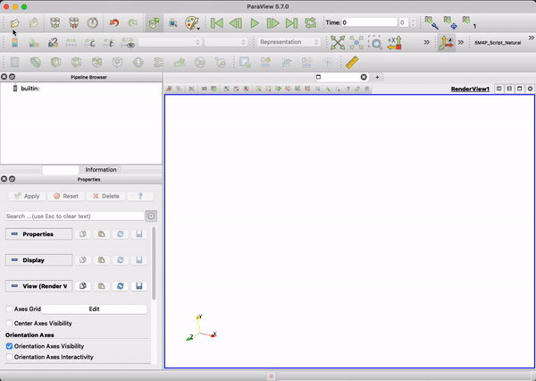
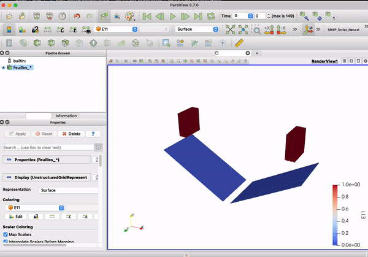
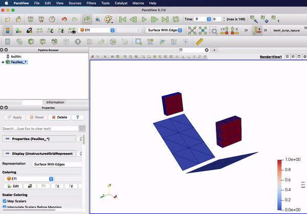

<style>
  .md-sidebar--secondary .md-nav__list .md-nav__list .md-nav__item .md-nav {
    display: none !important;
  }

  .md-typeset td:first-child, .md-typeset th:first-child {
    white-space: nowrap;
  }
</style>

# Post-processing

After successfully running a COMFOR simulation, results are available in various formats for analysis and visualization. This section explains how to access, visualize, and analyze your simulation results.

---

## Generated Result Files

### Directory Structure

For an input file `simulation.toml` with an output named `fields` and two trackers named `PunchForce` and `CenterPosition`:

```
Project_Folder/
├── simulation.toml              # Input file
├── simulation.md                # Job log
└── Results_simulation/          # Result root (or the path given with -o)
    ├── manifest.toml            # Run status and list of files
    ├── fields/                  # One folder per [[output]], named after it
    │   ├── fields_000000.vtu
    │   ├── fields_000001.vtu
    │   └── ...
    ├── PunchForce.csv           # One CSV file per [tracker], named after it
    └── CenterPosition.csv
```

- Frames are written every [`frequency`](preprocessing.md#output) time units and numbered with 6 digits, starting at `000000` (initial state).
- When several `[[output]]` blocks are defined, each one writes in its own folder.

### Run Manifest

`manifest.toml` is updated during the run. Its `status` is `running` during the simulation, then `completed` or `failed`. It also lists every file written (path, format and size):

```toml
schema_version = 1
status = 'completed'

[[artifacts]]
channel_id = 'fields'
format = 'vtu'
path = 'fields/fields_000000.vtu'
size = 34305
```

Checking `status = 'completed'` is a simple way to verify, in a script, that a simulation ended normally.

### Job Log

The job log `simulation.md` is a Markdown file written next to the input file. It contains the file information, the validation report (with the list of errors if any), the model summary and the energies printed at each output frame. See [Running the Analysis](analysis.md#generated_files).

---

## Output Formats

### VTU Format (Recommended)

[VTU (XML Unstructured Grid)](https://docs.vtk.org/en/latest/vtk_file_formats/vtkxml_file_format.html#unstructuredgrid){:target="_blank"} is the **recommended** output format for COMFOR. Legacy VTK is still supported. Both are industry standards for scientific visualization.

| Feature | VTU | VTK (legacy) |
| :--- | :---: | :---: |
| `ASCII` encoding | Yes | Yes |
| `BINARY` encoding (zlib compressed) | Yes | No |
| Stress/strain tensors | 6-component arrays | One scalar per component |
| Composite results (fiber, shear, resultants) | Yes | No |

**Configuration example:**

```toml
[[output]]
name = "fields"
type = "VTU"
format = "BINARY"  # or "ASCII"
frequency = 0.1    # Write every 0.1 time units
```

!!! tip "Recommendation"
    Use **BINARY** for production simulations to reduce file size. Use **ASCII** to inspect the files with a text editor.

---

## Data Included in VTU Files

### Nodal Data (Point Data)

| Data | Components | Description |
| :--- | :---: | :--- |
| `Displacement` | 3 | Displacement $[u_x, u_y, u_z]$ |
| `Velocity` | 3 | Velocity $[v_x, v_y, v_z]$ |
| `Acceleration` | 3 | Acceleration $[a_x, a_y, a_z]$ |
| `Force` | 3 | Resultant nodal force |
| `ContactForce` | 3 | Nodal contact force |
| `SlidingVelocity` | 3 | Contact sliding velocity |

The node coordinates are stored as the mesh points (`Position` in the file).

### Element Data (Cell Data)

| Data | Components | Description |
| :--- | :---: | :--- |
| `MaterialID` | 1 | Material identifier |
| `PartID` | 1 | Part identifier (order of the `part` blocks) |
| `PartInstanceID` | 1 | Instance identifier inside a part (see [`pattern`](preprocessing.md#part)) |
| `Stress` | 6 | Stress tensor in the element local frame |
| `Strain` | 6 | Strain tensor in the element local frame |
| `FiberStress` | 2 | Stress in the warp and weft directions (composite materials) |
| `FiberStrain` | 2 | Strain in the warp and weft directions (composite materials) |
| `ShearAngle` | 1 | In-plane shear angle between the fiber directions (composite materials) |
| `ShearStress` | 1 | In-plane shear stress (composite materials) |
| `ResultantN` | 3 | Membrane force resultants (shell sections) |
| `ResultantM` | 3 | Bending moment resultants (shell sections) |
| `ResultantQ` | 2 | Transverse shear resultants (shell sections) |

Values that do not apply to an element type are written as zero.

### Tensor Components

`Stress` and `Strain` are stored with 6 components, in this order:

| Index | Component | Description |
| :---: | :--- | :--- |
| 0 | `C11` | Normal in direction 1 |
| 1 | `C22` | Normal in direction 2 |
| 2 | `C33` | Normal in direction 3 |
| 3 | `C12` | Shear in plane 1-2 |
| 4 | `C13` | Shear in plane 1-3 |
| 5 | `C23` | Shear in plane 2-3 |

!!! warning "ParaView component names"
    ParaView labels 6-component arrays with its own symmetric tensor convention (`XX`, `YY`, `ZZ`, `XY`, `YZ`, `XZ`). Use the index above to identify a component: for instance the 5th component (index 4) is `C13`, even if ParaView names it `YZ`.

In legacy VTK files, each component is written as a separate scalar: `E11` ... `E23` for the strain and `S11` ... `S23` for the stress.

---

## Visualization with ParaView

[ParaView](https://www.paraview.org/){:target="_blank"} is the **recommended** visualization tool for COMFOR results.

### Load the Files

Click on **File → Open** and navigate to the folder of your output (e.g. `Results_simulation/fields/`). Since **COMFOR** names files in ascending order (`fields_..vtu`), ParaView automatically proposes to open them as a **file group** (time series).

<div style="text-align:center;">
    <figure>
        
        <figcaption>Loading the files</figcaption>
    </figure>
</div>

### Play the Animation

After opening the files, they appear in the **Pipeline Browser**. Click the **Apply** button in the Properties section to render the mesh.

!!! tip "Workflow Hint"
    To save time, activate **Auto Apply** in *Edit → Settings → General → Properties Panel Options*.

To play the animation, use the **Play** button on the VCR toolbar. You can navigate frame by frame, loop the animation, or jump to specific time steps using the time toolbar.

The data to be displayed can be selected in the **Coloring** dropdown menu of the Properties panel. You can visualize nodal data (e.g. `Displacement`) or element data (e.g. `Stress`, `ShearAngle`), and choose the component or the magnitude.

<div style="text-align:center;">
    <figure>
        
        <figcaption>Playing the animation</figcaption>
    </figure>
</div>

!!! info "Deformed shape"
    The mesh points are written at their **current** position: the geometry displayed in ParaView is already the deformed one. The `Displacement` field can be used to color the mesh, or with the **`Warp By Vector`** filter to amplify the deformation.

### Applying Filters

ParaView provides a wide range of [filters](https://docs.paraview.org/en/latest/Tutorials/ClassroomTutorials/beginningSourcesAndFilters.html){:target="_blank"} to process and analyze simulation data. Filters can be stacked in the Pipeline Browser to combine effects.

Commonly used filters for **COMFOR** simulations:

| Filter | Use |
| :--- | :--- |
| **`Threshold`** | Extract the elements whose value lies in a range (e.g. `PartID` to isolate a part, or `ShearAngle` to find the highly sheared zones) |
| **`Connectivity`** | Identify connected regions, e.g. to separate the tools from the composite plates |
| **`Cell Data to Point Data`** | Average element data at the nodes (smoother contour plots) |
| **`Warp By Vector`** | Amplify a deformation using a vector field |
| **`Temporal Interpolator`** | Interpolate between frames, for smooth animations |
| **`Plot Data Over Time`** | Plot the time evolution of a selection |
| **`Plot Data`** | Plot data arrays, e.g. the content of a tracker CSV file |

<div style="text-align:center;">
    <figure>
        
        <figcaption>Applying filters</figcaption>
    </figure>
</div>

---

## CSV Files (Trackers)

[Trackers](modules/trackers.md) record the time history of specific variables in **CSV** files, one file per tracker: `<result_root>/<tracker_name>.csv`. A row is written each time an output frame is written.

### CSV File Format

- **Header line**: `Time`, one column per tracked entity, then `Total`
- **Separator**: comma followed by a space (`, `)
- **Total**: sum of the values of all tracked entities

**Example (NODE tracker, `variable = "FORCE"`, `direction = "Z"`):**

```csv
Time, Node 101, Node 102, Node 103, Total
0, 0, 0, 0, 0
0.1, 50.2, 48.7, 52.1, 151
0.2, 100.5, 95.3, 105.8, 301.6
```

**Example (ELEMENT tracker, `variable = "STRESS"`, `component = "C11"`):**

```csv
Time, Element 50, Element 51, Element 52, Total
0, 0, 0, 0, 0
0.1, 15.2, 18.1, 14.5, 47.8
0.2, 20.1, 22.5, 19.8, 62.4
```

### CSV Analysis with Python

```python
import pandas as pd
import matplotlib.pyplot as plt

# skipinitialspace removes the space after each comma
df = pd.read_csv('Results_simulation/PunchForce.csv', skipinitialspace=True)

plt.plot(df['Time'], df['Total'], label='Punch force')
plt.xlabel('Time')
plt.ylabel('Force')
plt.grid(True)
plt.legend()
plt.show()
```

**Force-displacement curve**, with a `NODE` tracker on the punch force and a `POSITION` tracker on a punch node:

```python
force = pd.read_csv('Results_simulation/PunchForce.csv', skipinitialspace=True)
position = pd.read_csv('Results_simulation/PunchPosition.csv', skipinitialspace=True)

# Punch displacement from its initial position
displacement = position['Total'].iloc[0] - position['Total']

plt.plot(displacement, force['Total'])
plt.xlabel('Punch displacement')
plt.ylabel('Punch force')
plt.show()
```

The corresponding trackers:

```toml
[tracker.PunchForce]
type = "NODE"
variable = "FORCE"
direction = "Z"
set = "PunchNodes"

[tracker.PunchPosition]
type = "NODE"
variable = "POSITION"
direction = "Z"
nodes = [50]
```

The CSV files can also be opened directly in ParaView (with the **Plot Data** filter), Excel or LibreOffice Calc.

---

## Troubleshooting

| Issue | Solution |
| :--- | :--- |
| No time series detected in ParaView | Open the files from the output folder (`Results_<name>/<output_name>/`) and select the `..vtu` group |
| A stress/strain component is not the expected one | Use the component index, not the ParaView label (see [Tensor Components](#tensor_components)) |
| Composite fields are zero | `FiberStress`, `ShearAngle`, etc. are only computed for composite materials |
| `KeyError: 'Total'` with pandas | Use `skipinitialspace=True` in `read_csv` |
| `manifest.toml` status is `failed` | Read the error at the end of the job log (`<input_name>.md`) |

---

## Resources

For in-depth ParaView training, consult these resources:

  - [Official ParaView Tutorial](https://www.paraview.org/Wiki/The_ParaView_Tutorial){:target="\_blank"}
  - [ParaView Documentation](https://docs.paraview.org/){:target="\_blank"}
  - [Cyprien Rusu - ParaView for FEA](https://youtube.com/playlist?list=PLvkU6i2iQ2fpcVsqaKXJT5Wjb9_ttRLK-){:target="\_blank"}
